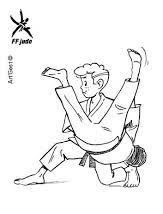
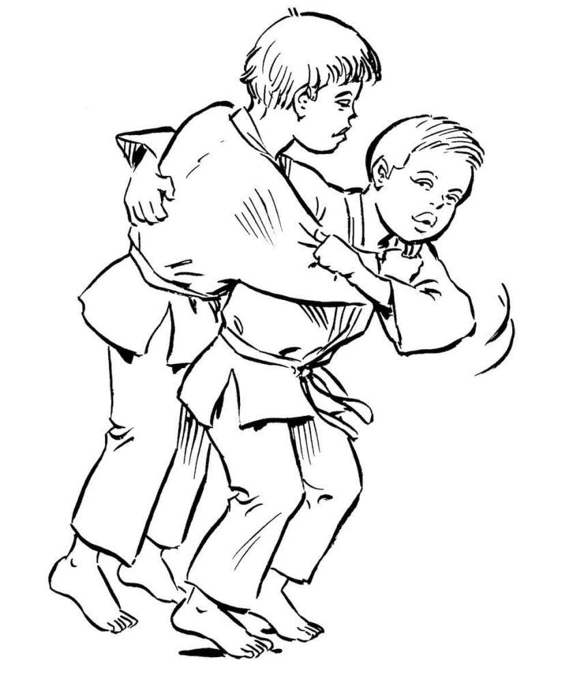
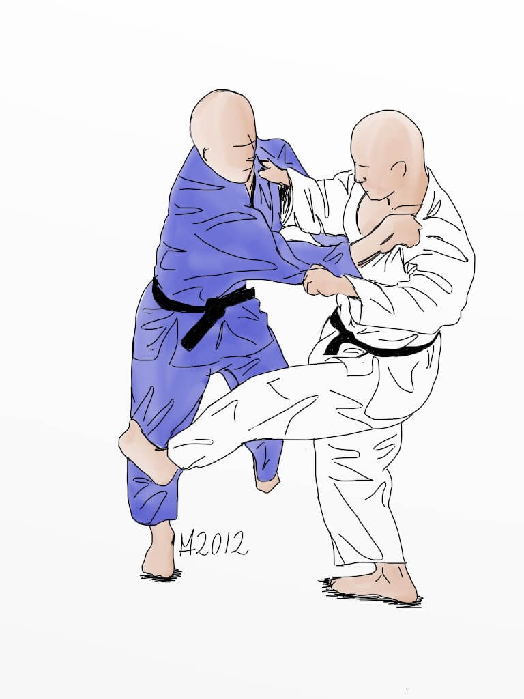
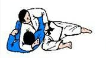

# 🥋 Guía de Estudio: Nage-no-Kata (1.er Dan / Shodan)

---

## 📌 Clasificación General de las Katas Oficiales

El programa de examen técnico para el grado de *Shodan* abarca las proyecciones de pie (*Nage-waza*) a través del **Nage-no-Kata** y los controles de suelo (*Katame-waza*) a través del **Katame-no-Kata**:

| Kata | Enfoque Principal | Familias Incluidas | N.º de Técnicas |
| :--- | :--- | :--- | :---: |
| **Nage-no-Kata** | Proyecciones de Pie (*Tachi-waza*) | *Te-waza*, *Koshi-waza*, *Ashi-waza*, *Ma-sutemi*, *Yoko-sutemi* | **15** |
| **Katame-no-Kata** | Controles de Suelo (*Ne-waza*) | *Osaekomi-waza*, *Shime-waza*, *Kansetsu-waza* | **15** |

---

## 📌 Clasificación General de las Técnicas (Nage-waza)

El programa oficial de proyección de pie (*Tachi-waza*) para el grado de *Shodan* se clasifica en cinco familias principales:

| Grupo | Nombre Japonés | Traducción Técnica |
| :--- | :--- | :--- |
| **1.** | *Te-waza* | Técnicas de brazo / mano |
| **2.** | *Koshi-waza* | Técnicas de cadera |
| **3.** | *Ashi-waza* | Técnicas de pie / pierna |
| **4.** | *Ma-sutemi-waza* | Técnicas de sacrificio dorsal (hacia atrás) |
| **5.** | *Yoko-sutemi-waza* | Técnicas de sacrificio lateral (de costado) |

---

## 📌 Clasificación General de las Técnicas de Suelo (Katame-waza)

El programa oficial de control en suelo (*Ne-waza*) para el grado de *Shodan* se clasifica en tres familias principales:

| Grupo | Nombre Japonés | Traducción Técnica |
| :--- | :--- | :--- |
| **1.** | *Osaekomi-waza* | Técnicas de inmovilización / control corporal |
| **2.** | *Shime-waza* | Técnicas de estrangulación (al cuello / solapa) |
| **3.** | *Kansetsu-waza* | Técnicas de luxación articular (articulación del codo) |

---

## 🥋 Parte 1: Las 15 Técnicas del Nage-no-Kata (Proyecciones)

---

### 1. Te-waza (Técnicas de Brazo)

| N.º | Técnica | Traducción | Ilustración / Imagen |
| :---: | :--- | :--- | :---: |
| **1** | *Uki otoshi* | Proyección flotante |  |
| **2** | *Seoi nage* | Proyección cargando sobre la espalda |  |
| **3** | *Kata guruma* | Rueda sobre los hombros *(Molinete)* |  |

---

### 2. Koshi-waza (Técnicas de Cadera)

| N.º | Técnica | Traducción | Ilustración / Imagen |
| :---: | :--- | :--- | :---: |
| **4** | *Uki goshi* | Cadera flotante |  |
| **5** | *O goshi* | Gran cadera |  |
| **6** | *Harai goshi* | Cadera barrida |  |

---

### 3. Ashi-waza (Técnicas de Pie / Pierna)

| N.º | Técnica | Traducción | Ilustración / Imagen |
| :---: | :--- | :--- | :---: |
| **7** | *Deashi barai* | Barrido al pie de salida |  |
| **8** | *Hiza guruma* | Rueda a la rodilla |  |
| **9** | *Sasae tsurikomi ashi* | Pie bloqueado pescando |  |

---

### 4. Ma-sutemi-waza (Técnicas de Sacrificio Hacia Atrás)

| N.º | Técnica | Traducción | Ilustración / Imagen |
| :---: | :--- | :--- | :---: |
| **10** | *Tomoe nage* | Proyección en círculo |  |
| **11** | *Sumi gaeshi* | Inversión a la esquina |  |
| **12** | *Ura nage* | Proyección hacia atrás *(Suplex)* |  |

---

### 5. Yoko-sutemi-waza (Técnicas de Sacrificio Lateral)

| N.º | Técnica | Traducción | Ilustración / Imagen |
| :---: | :--- | :--- | :---: |
| **13** | *Yoko otoshi* | Caída lateral |  |
| **14** | *Tani otoshi* | Caída al valle |  |
| **15** | *Soto makikomi* | Envolvente exterior |  |

---

## 🤼 Parte 2: Las 15 Técnicas del Katame-no-Kata (Suelo / Ne-waza)

---

### 1. Osaekomi-waza (Técnicas de Inmovilización)

| N.º | Técnica | Traducción | Ilustración / Imagen |
| :---: | :--- | :--- | :---: |
| **1** | *Kesa-gatame* | Inmovilización fundamental en bufanda |  |
| **2** | *Kata-gatame* | Inmovilización por el hombro |  |
| **3** | *Kami-shiho-gatame* | Inmovilización superior de cuatro puntos |  |
| **4** | *Yoko-shiho-gatame* | Inmovilización lateral de cuatro puntos |  |
| **5** | *Kuzure-kami-shiho-gatame* | Variante de inmovilización superior |  |

---

### 2. Shime-waza (Técnicas de Estrangulación)

| N.º | Técnica | Traducción | Ilustración / Imagen |
| :---: | :--- | :--- | :---: |
| **6** | *Kata-juji-jime* | Estrangulación cruzada mixta / de lado |  |
| **7** | *Hadaka-jime* | Estrangulación a cuello desnudo (sin solapa) |  |
| **8** | *Okuri-eri-jime* | Estrangulación deslizando la solapa |  |
| **9** | *Kata-ha-jime* | Estrangulación atrapando un hombro/brazo |  |
| **10** | *Gyaku-juji-jime* | Estrangulación cruzada inversa |  |

---

### 3. Kansetsu-waza (Técnicas de Luxación / Articulación)

| N.º | Técnica | Traducción | Ilustración / Imagen |
| :---: | :--- | :--- | :---: |
| **11** | *Ude-garami* | Luxación de brazo entrelazado / en llave |  |
| **12** | *Ude-hishigi-juji-gatame* | Luxación de brazo en cruz |  |
| **13** | *Ude-hishigi-ude-gatame* | Luxación aprisionando el brazo con las manos |  |
| **14** | *Ude-hishigi-hiza-gatame* | Luxación de brazo apoyado en la rodilla |  |
| **15** | *Ude-hishigi-waki-gatame* | Luxación de brazo apoyado en la axila |  |

---

## ⚖️ Criterios de Evaluación y Principios del Examen (Shodan)

El tribunal examinador evaluará el dominio técnico y conceptual basándose en los siguientes parámetros fundamentales:

| Aspecto de Evaluación | Concepto en Judo | Descripción y Puntos Clave a Demostrar |
| :--- | :--- | :--- |
| **1. Principio Técnico** | *Riai* | Coherencia y lógica marcial en la aplicación de la técnica, respetando la distancia y la física del desplazamiento. |
| **2. Desequilibrio** | *Kuzushi* | Romper la estabilidad del oponente en las ocho direcciones tradicionales (*Happo-no-kuzushi*) antes de proyectar. |
| **3. Posicionamiento** | *Tsukuri* | Entrada fluida y colocación óptima del cuerpo de *Tori* para facilitar la ejecución sin forcejeos innecesarios. |
| **4. Proyección / Control** | *Kake* | Momento exacto y culminación del lanzamiento (*Nage-waza*) o fijación del control absoluto en suelo (*Katame-waza*). |
| **5. Etiqueta y Postura** | *Reigi / Rei* | Correcto saludo al tatami y al compañero (*Zarei* / *Ritsurei*), compostura, seriedad y fluidez en la transición entre técnicas. |