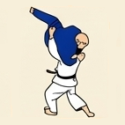
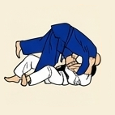
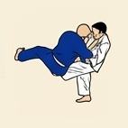

# 🥋 Gokyo 5: 1.er Kyu (Cinturón Marrón)

---

## 📌 Resumen del Grado

El último grupo del Gokyo reúne las técnicas avanzadas, contrataques de barrido y lanzamientos de alto riesgo previos al grado de *Shodan* (Cinturón Negro).

---

## 🥋 Técnicas Oficiales

| N.º | Grupo | Técnica | Traducción | Ilustración |
| :---: | :--- | :--- | :--- | :---: |
| **1** | Te-waza | *Ippon-seoi-nage* | Proyección sobre la espalda por un brazo |  |
| **2** | Koshi-waza | *O-soto-otoshi* | Gran caída exterior |  |
| **3** | Ashi-waza | *Tsubame-gaeshi* | Inversión de golondrina |  |
| **4** | Ashi-waza | *O-soto-gaeshi* | Contra de gran sega exterior |  |
| **5** | Ashi-waza | *Harai-goshi-gaeshi* | Contra de barrido de cadera |  |
| **6** | Ma-sutemi-waza | *Ura-nage* | Proyección hacia atrás |  |
| **7** | Yoko-sutemi-waza | *Yoko-guruma* | Rueda lateral |  |
| **8** | Yoko-sutemi-waza | *Yoko-gake* | Enganche lateral |  |