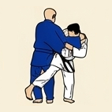
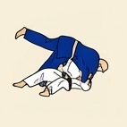
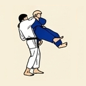
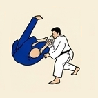

# 🥋 Gokyo 1: 5.º Kyu (Cinturón Amarillo)

---

## 📌 Resumen del Grado

El primer grado establece las bases del Judo de pie (*Tachi-waza*) a través de 8 proyecciones fundamentales, e introduce las inmovilizaciones básicas en el trabajo de suelo (*Ne-waza*).

---

## 🥋 Técnicas de Pie (Nage-waza)

| N.º | Grupo | Técnica | Traducción | Ilustración |
| :---: | :--- | :--- | :--- | :---: |
| **1** | Ashi-waza | *Osoto-guruma* | Gran rueda exterior |  |
| **2** | Te-waza | *Uki-otoshi* | Caída flotante |  |
| **3** | Yoko-sutemi-waza | *Yoko-wakare* | Separación lateral |  |
| **4** | Yoko-sutemi-waza | *Yoko-guruma* | Rueda lateral |  |
| **5** | Koshi-waza | *Ushiro-goshi* | Cadera hacia atrás |  |
| **6** | Ma-sutemi-waza | *Ura-nage* | Proyección hacia atrás |  |
| **7** | Te-waza | *Sumi-otoshi* | Caída en la esquina |  |
| **8** | Yoko-sutemi-waza | *Yoko-gake* | Gancho lateral |  |

---

## 🤼 Técnicas de Suelo (Katame-waza / Ne-waza)

| N.º | Grupo | Técnica | Traducción | Ilustración |
| :---: | :--- | :--- | :--- | :---: |
| **1** | Osaekomi-waza | *Hon-kesa-gatame* | Inmovilización fundamental en bufanda |  |
| **2** | Osaekomi-waza | *Kuzure-kesa-gatame* | Variante de inmovilización en bufanda |  |
| **3** | Osaekomi-waza | *Yoko-shiho-gatame* | Inmovilización lateral de cuatro puntos |  |
| **4** | Osaekomi-waza | *Kami-shiho-gatame* | Inmovilización superior de cuatro puntos |  |
| **5** | Osaekomi-waza | *Tate-shiho-gatame* | Inmovilización longitudinal a caballo |  |