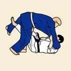
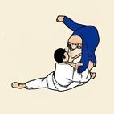
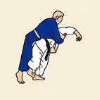
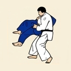
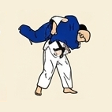
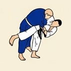
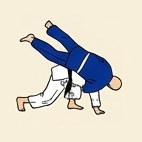
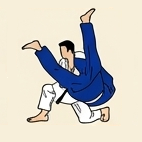

# 🥋 Gokyo 4: 2.º Kyu (Cinturón Azul)

---

## 📌 Resumen del Grado

El cuarto grupo exige un control avanzado del equilibrio y del timing, ampliando el repertorio de sacrificios y proyecciones circulares grandes.

---

## 🥋 Técnicas Oficiales

| N.º | Grupo | Técnica | Traducción | Ilustración | Nage-no-Kata (15) |
| :---: | :--- | :--- | :--- | :---: | :---: |
| **1** | Ma-sutemi-waza | *Sumi-gaeshi* | Contraataque en rincón |  | ✅ |
| **2** | Yoko-sutemi-waza | *Tani-otoshi* | Caída en el valle |  | ❌ |
| **3** | Yoko-sutemi-waza | *Hane-makikomi* | Proyección enrollándose con salto |  | ❌ |
| **4** | Te-waza | *Sukui-nage* | Proyección cucharada |  | ❌ |
| **5** | Koshi-waza | *Utsuri-goshi* | Cambio de cadera |  | ❌ |
| **6** | Ashi-waza | *O-guruma* | Gran rueda |  | ❌ |
| **7** | Yoko-sutemi-waza | *Soto-makikomi* | Gran rollo exterior |  | ❌ |
| **8** | Te-waza | *Uki-otoshi* | caída flotante |  | ✅ |

## 🤼 Técnicas de Suelo (Katame-waza / Ne-waza)

| N.º | Grupo | Técnica | Traducción | Ilustración |
| :---: | :--- | :--- | :--- | :---: |
| **1** | Shime-waza | *Ryote-jime* | Estrangulación con dos manos |  |
| **2** | Shime-waza | *Sode-guruma-jime* | Estrangulación envolviendo con la manga |  |
| **3** | Kansetsu-waza | *Ude-hishigi-ude-gatame* | Luxación aprisionando el brazo con las manos |  |
| **4** | Kansetsu-waza | *Ude-hishigi-waki-gatame* | Luxación de brazo apoyado en la axila |  |
| **5** | Kansetsu-waza | *Ude-hishigi-hiza-gatame* | Luxación de brazo apoyado en la rodilla |  |