# 🥋 Gokyo 3: 3.er Kyu (Cinturón Verde)

---

## 📌 Resumen del Grado

El tercer grupo incorpora técnicas complejas de nivel intermedio, introduciendo el enganche exterior, barridos profundos y la primera técnica de sacrificio lateral (*Yoko-sutemi-waza*).

---

## 🥋 Técnicas Oficiales

| N.º | Grupo | Técnica | Traducción | Ilustración |
| :---: | :--- | :--- | :--- | :---: |
| **1** | Ashi-waza | *Kosoto-gake* | Pequeño enganche exterior | 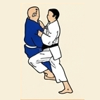 |
| **2** | Koshi-waza | *Tsuri-goshi* | Elevar con la cadera sujetando el cinturón | 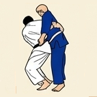 |
| **3** | Yoko-sutemi-waza | *Yoko-otoshi* | Caída lateral | 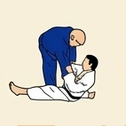 |
| **4** | Ashi-waza | *Ashi-guruma* | Rueda por la pierna | 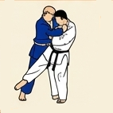 |
| **5** | Koshi-waza | *Hane-goshi* | Cadera en resorte / salto | 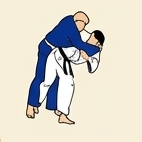 |
| **6** | Ashi-waza | *Harai-tsurikomi-ashi* | Barrido al pie tirando y levantando | 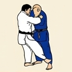 |
| **7** | Ma-sutemi-waza | *Tomoe-nage* | Proyección en círculo | 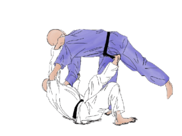 |
| **8** | Te-waza | *Kata-guruma* | Rueda por los hombros | 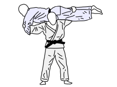 |

## 🤼 Técnicas de Suelo (Katame-waza / Ne-waza)

| N.º | Grupo | Técnica | Traducción | Ilustración |
| :---: | :--- | :--- | :--- | :---: |
| **1** | Shime-waza | *Hadaka-jime* | Estrangulación a cuello desnudo | 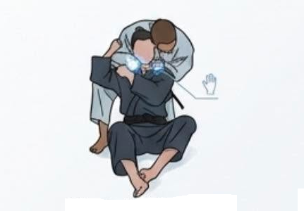 |
| **2** | Shime-waza | *Okuri-eri-jime* | Estrangulación deslizando la solapa | 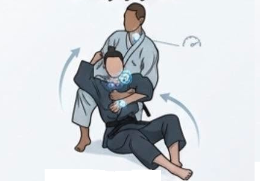 |
| **3** | Shime-waza | *Kata-ha-jime* | Estrangulación atrapando un ala/hombro | 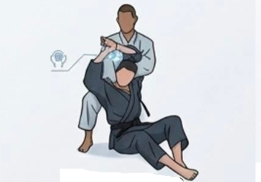 |
| **4** | Kansetsu-waza | *Ude-hishigi-juji-gatame* | Luxación de brazo en cruz |  |
| **5** | Kansetsu-waza | *Ude-garami* | Luxación de brazo entrelazado | 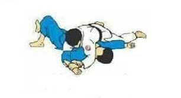 |