# 🥋 Gokyo 2: 4.º Kyu (Cinturón Naranja)

---

## 📌 Resumen del Grado

El segundo grupo introduce combinaciones de mayor velocidad, desplazamientos circulares y la primera técnica de sacrificio (*Ma-sutemi-waza*).

---

## 🥋 Técnicas Oficiales

| N.º | Grupo | Técnica | Traducción | Ilustración |
| :---: | :--- | :--- | :--- | :---: |
| **1** | Ashi-waza | *Kosoto-gari* | Pequeña sega exterior | 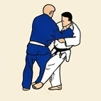 |
| **2** | Ashi-waza | *Kouchi-gari* | Pequeña sega interior |  |
| **3** | Koshi-waza | *Koshi-guruma* | Rueda de cadera | 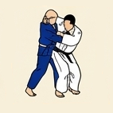 |
| **4** | Koshi-waza | *Tsurikomi-goshi* | Proyección de cadera tirando y levantando | 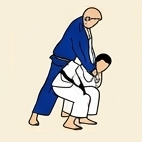 |
| **5** | Ashi-waza | *Okuri-ashi-harai* | Barrido de ambos pies en movimiento | 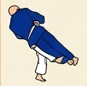 |
| **6** | Te-waza | *Tai-otoshi* | Caída del cuerpo | 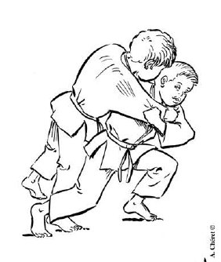 |
| **7** | Koshi-waza | *Harai-goshi* | Barrer con la cadera | 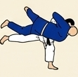 |
| **8** | Ashi-waza | *Uchi-mata* | Proyección por el interior del muslo | 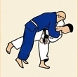 |

## 🤼 Técnicas de Suelo (Katame-waza / Ne-waza)

| N.º | Grupo | Técnica | Traducción | Ilustración |
| :---: | :--- | :--- | :--- | :---: |
| **1** | Osaekomi-waza | *Kata-gatame* | Inmovilización por el hombro | 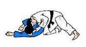 |
| **2** | Osaekomi-waza | *Kuzure-kami-shiho-gatame* | Variante de inmovilización superior | 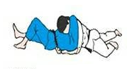 |
| **3** | Shime-waza | *Nami-juji-jime* | Estrangulación cruzada normal | 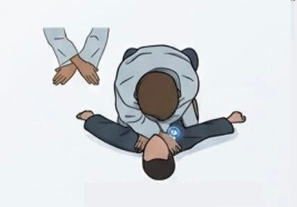 |
| **4** | Shime-waza | *Gyaku-juji-jime* | Estrangulación cruzada inversa | 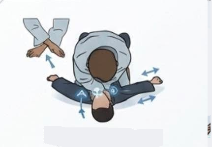 |
| **5** | Shime-waza | *Kata-juji-jime* | Estrangulación cruzada de lado | 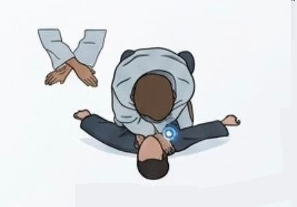 |