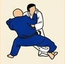

# 🥋 Gokyo 2: 4.º Kyu (Cinturón Naranja)

---

## 📌 Resumen del Grado

El segundo grupo introduce combinaciones de mayor velocidad, desplazamientos circulares y la primera técnica de sacrificio (*Ma-sutemi-waza*).

---

## 🥋 Técnicas Oficiales

| N.º | Grupo | Técnica | Traducción | Ilustración |
| :---: | :--- | :--- | :--- | :---: |
| **1** | Te-waza | *Tai-otoshi* | Caída del cuerpo |  |
| **2** | Koshi-waza | *Koshi-guruma* | Rueda de cadera |  |
| **3** | Koshi-waza | *Harai-goshi* | Barrer con la cadera |  |
| **4** | Koshi-waza | *Tsurikomi-goshi* | Proyección de cadera tirando y levantando |  |
| **5** | Ashi-waza | *O-uchi-gari* | Gran sega interior |  |
| **6** | Ashi-waza | *Ko-uchi-gari* | Pequeña sega interior |  |
| **7** | Ashi-waza | *Okuri-ashi-harai* | Barrido de ambos pies en movimiento |  |
| **8** | Ma-sutemi-waza | *Tomoe-nage* | Proyección en círculo |  |