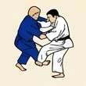
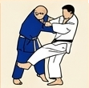
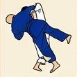
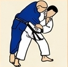
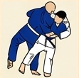
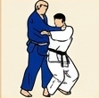
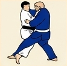
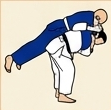

# 🥋 Gokyo 1: 5.º Kyu (Cinturón Amarillo)

---

## 📌 Resumen del Grado

El primer grupo del Gokyo establece las bases mecánicas del Judo a través de 8 técnicas fundamentales de Brazo (*Te-waza*), Cadera (*Koshi-waza*) y Pierna (*Ashi-waza*).
140
---

## 🥋 Técnicas Oficiales

| N.º | Grupo | Técnica | Traducción | Ilustración | Nage-no-Kata (15) |
| :---: | :--- | :--- | :--- | :---: | :---: |
| **1** | Ashi-waza | *De-ashi-barai (harai)* | Barrido al pie que avanza |  | ❌ |
| **2** | Ashi-waza | *Hiza-guruma* | Rueda a la rodilla |  | ❌ |
| **3** | Ashi-waza | *Sasae-tsurikomi-ashi* | Bloqueo al tobillo tirando y levantando |  | ✅ |
| **4** | Koshi-waza | *Uki-goshi* | Cadera flotante |  | ✅ |
| **5** | Ashi-waza | *O-soto-gari* | Gran sega exterior |  | ❌ |
| **6** | Koshi-waza | *O-goshi* | Gran cadera |  | ❌ |
| **7** | Ashi-waza | *Ouchi-gari* | Gran sega interior |  | ❌ |
| **8** | Te-waza | *Seoi-nage* | Proyección de hombro a través de un punto |  | ✅ |

## 🤼 Técnicas de Suelo (Katame-waza / Ne-waza)

| N.º | Grupo | Técnica | Traducción | Ilustración |
| :---: | :--- | :--- | :--- | :---: |
| **1** | Osaekomi-waza | *Hon-kesa-gatame* | Inmovilización fundamental en bufanda |  |
| **2** | Osaekomi-waza | *Kuzure-kesa-gatame* | Variante de inmovilización en bufanda |  |
| **3** | Osaekomi-waza | *Yoko-shiho-gatame* | Inmovilización lateral de cuatro puntos |  |
| **4** | Osaekomi-waza | *Kami-shiho-gatame* | Inmovilización superior de cuatro puntos |  |
| **5** | Osaekomi-waza | *Tate-shiho-gatame* | Inmovilización longitudinal a caballo |  |