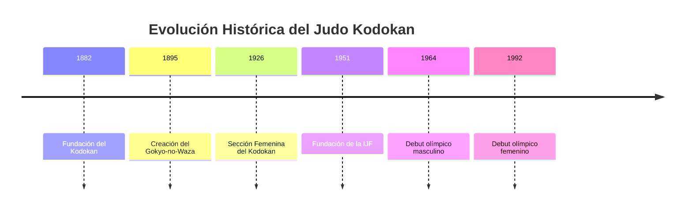
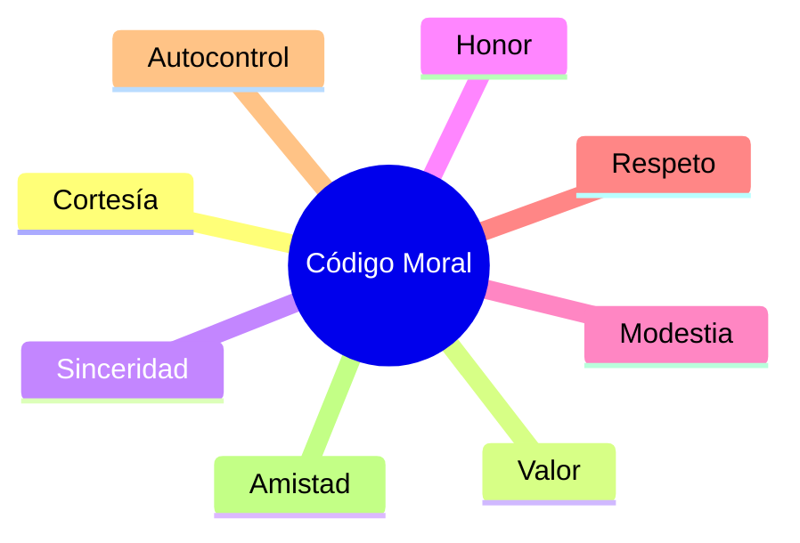
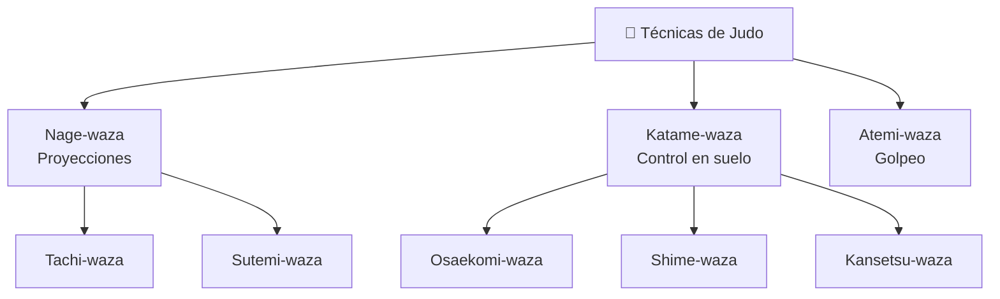
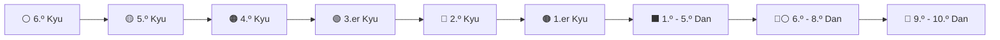

# 🥋 Base de Conocimiento de Judo (Jūdō - 柔道)

> *"El Judo no es únicamente un deporte o un método de combate; es una vía de educación integral para el desarrollo físico, mental y moral del individuo."*
>
> **Shihan Jigorō Kanō**  
> Fundador del Judo

---

## 📌 Tabla de Contenidos

- [📖 Historia y Orígenes](#-principios-filosóficos-y-código-moral
- [🏛️ Clasificación de las Técnicasaza
- [🥋 Sistema de Grados y Cinturones](#-sistema-de-grados-y-cinturonessitorio](#-estructura-del-repositorioistoria y Orígenes

El **Judo** fue fundado en **1882** en Tokio, Japón, por el maestro **Jigorō Kanō (嘉納 治五郎)**.

Kanō estudió diversas escuelas tradicionales de **Jujutsu**, principalmente **Kitō-ryū** y **Tenjin Shin'yō-ryū**, caracterizadas por técnicas de combate cuerpo a cuerpo utilizadas por los antiguos samuráis.

Tras refinar dichas técnicas y eliminar aquellas consideradas excesivamente peligrosas para la práctica educativa, creó el **Kodokan (講道館)**, transformando un arte de combate (*Bujutsu*) en un camino de perfeccionamiento personal (*Budō*).

## ⏳ Hitos Históricos del Judo

---

# ☯️ Principios Filosóficos y Código Moral

El Judo se apoya en tres principios fundamentales desarrollados por Jigorō Kanō.

| Principio | Nombre Japonés | Concepto |
|------------|------------|------------|
| **Ju** | 柔 (*Jū*) | Adaptabilidad y flexibilidad. Ceder ante la fuerza del oponente para utilizarla a favor propio. |
| **Seiryoku Zen'yō** | 精力善用 | Máxima eficacia utilizando el mínimo esfuerzo necesario. |
| **Jita Kyōei** | 自他共栄 | Prosperidad y beneficio mutuo mediante el respeto y la cooperación. |

---

## 📜 Código Moral del Judoca

Los valores del Judo deben reflejarse tanto dentro como fuera del tatami.

### Valores Fundamentales

| Valor | Japonés | Significado |
|---------|---------|---------|
| 🤝 Cortesía | Reigi | Respeto y educación hacia los demás. |
| 🦁 Valor | Yūki | Hacer lo correcto incluso ante la dificultad. |
| 🎯 Sinceridad | Makoto | Actuar y expresarse con honestidad. |
| ⚔️ Honor | Meiyo | Ser digno de confianza y fiel a la palabra dada. |
| 🌱 Modestia | Kenkyō | Reconocer las propias limitaciones y méritos con humildad. |
| 🙏 Respeto | Sonkei | Consideración hacia los demás. |
| 🧘 Autocontrol | Jisei | Dominio de emociones y acciones. |
| 🤗 Amistad | Yūjō | Fraternidad y solidaridad entre compañeros. |

---

# 🏛️ Clasificación de las Técnicas (Waza)

Las técnicas del Judo se organizan en tres grandes categorías:

- **Nage-waza** (Técnicas de proyección)
- **Katame-waza** (Técnicas de control)
- **Atemi-waza** (Técnicas de golpeo utilizadas principalmente en katas avanzadas)

---

# 🥋 Sistema de Grados y Cinturones (Kyu y Dan)

La progresión técnica del Judoca se divide en:

- **Kyu** → grados estudiantiles.
- **Dan** → grados de maestría.

### Escalafón de Grados

| Grado | Cinturón |
|---------|---------|
| 6.º Kyu | ⚪ Blanco |
| 5.º Kyu | 🟡 Amarillo |
| 4.º Kyu | 🟠 Naranja |
| 3.er Kyu | 🟢 Verde |
| 2.º Kyu | 🔵 Azul |
| 1.er Kyu | 🟤 Marrón |
| 1.º - 5.º Dan | ⬛ Negro |
| 6.º - 8.º Dan | 🔴⚪ Rojo y Blanco |
| 9.º - 10.º Dan | 🔴 Rojo |

---

# 📂 Estructura del Repositorio y Guías de Estudio

Las guías están organizadas según el nivel técnico del practicante.

| Archivo | Nivel | Descripción |
|----------|--------|-------------|
| `5-kyu-amarillo.md` | 5.º Kyu | Gokyo I: Técnicas básicas de proyección y suelo. |
| `4-kyu-naranja.md` | 4.º Kyu | Gokyo II. |
| `3-kyu-verde.md` | 3.er Kyu | Gokyo III. |
| `2-kyu-azul.md` | 2.º Kyu | Gokyo IV. |
| `1-kyu-marron.md` | 1.er Kyu | Gokyo V. |
| `shodan.md` | 1.er Dan | Nage-no-Kata y Katame-no-Kata. |
| `glosario-terminos.md` | General | Diccionario de terminología japonesa. |

---

## 🎯 Objetivo del Repositorio

Este repositorio busca servir como:

- 📚 Material de estudio permanente.
- 🥋 Referencia técnica para practicantes.
- 🇯🇵 Apoyo al aprendizaje de terminología japonesa.
- 🏆 Preparación para exámenes de grado.
- 🤝 Conservación de los principios del Judo Kodokan.

---

### 「精力善用 • 自他共栄」

**Seiryoku Zen'yō • Jita Kyōei**

*"Máxima eficacia con el mínimo esfuerzo y prosperidad mutua."*

---

*Guía de estudio y referencia técnica para la práctica del Judo Kodokan.*

