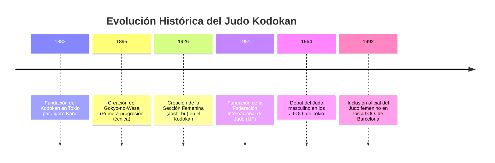
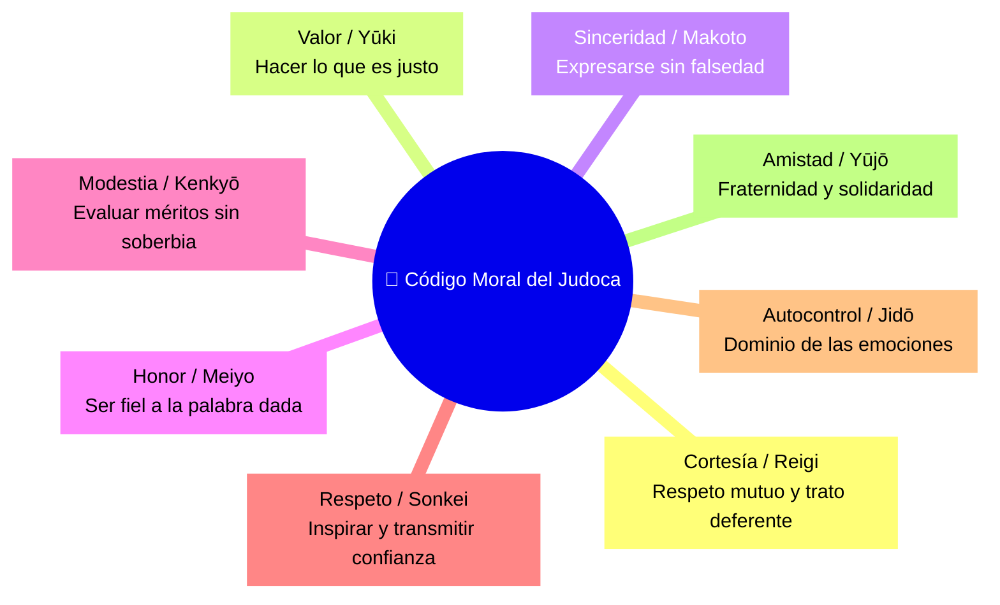
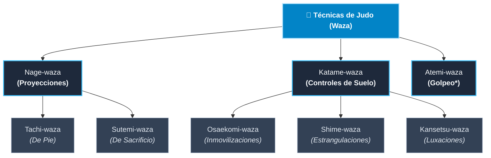

🥋 Base de Conocimiento de Judo (Jūdō - 柔道)
> *"El Judo no es únicamente un deporte o un método de combate; es una vía de educación integral para el desarrollo físico, mental y moral del individuo."*  
> — **Shihan Jigorō Kanō** (Fundador del Judo)
---
📌 Tabla de Contenidos
📖 Historia y Orígenes
☯️ Principios Filosóficos y Código Moral
🏛️ Clasificación de las Técnicas (Waza)
🥋 Sistema de Grados y Cinturones (Kyu y Dan)
📂 Estructura del Repositorio y Guías de Estudio
---
📖 Historia y Orígenes
El Judo fue fundado en 1882 en Tokio, Japón, por el maestro Jigorō Kanō (嘉納 治五郎). Kanō estudió diversas escuelas clásicas de Jujutsu tradicional (Kitō-ryū y Tenjin Shin'yō-ryū), caracterizadas por el combate cuerpo a cuerpo de los guerreros samuráis.
Refinando estas técnicas y eliminando los ataques letales o peligrosos, estructuró un método educativo en su escuela, el Kodokan (講道館), transformando un arte de combate (Bujutsu) en una vía de desarrollo personal y disciplina de vida (Budō).
⏳ Hitos Históricos del Judo

---
☯️ Principios Filosóficos y Código Moral
El Judo se sustenta sobre tres pilares filosóficos interconectados desarrollados por Jigorō Kanō:
Principio	Nombre Japonés	Concepto y Aplicación
Ju	Jū (柔)	Suavidad / Adaptabilidad: Ceder ante la fuerza del oponente para redirigir su energía y vencer sin oponer resistencia directa.
Seiryoku Zen'yo	Seiryoku Zen'yō (精力善用)	Máxima Eficacia con el Mínimo Esfuerzo: Utilizar la energía física y mental de la forma más eficiente posible.
Jita Kyoei	Jita Kyōei (自他共栄)	Prosperidad y Beneficio Mutuo: El progreso individual debe contribuir al bienestar, respeto y desarrollo de la comunidad.
---
📜 El Código Moral del Judoca
Los valores inculcados dentro del Dōjō rigen la conducta y ética del practicante dentro y fuera del tatami:

---
🏛️ Clasificación de las Técnicas (Waza)
El repertorio del Judo se divide en tres grandes familias técnicas. Las técnicas de proyección (Nage-waza) y de control en suelo (Katame-waza) constituyen el pilar fundamental del aprendizaje diario, mientras que el Atemi-waza se reserva formalmente para las Katas superiores.

---
🥋 Sistema de Grados y Cinturones (Kyu y Dan)
La progresión en Judo se divide en grados estudiantiles (Kyu) y grados de maestría (Dan):
```mermaid
graph LR
    classDef kyu fill:#334155,stroke:#cbd5e1,stroke-width:1px,color:#f8fafc;
    classDef dan fill:#0f172a,stroke:#38bdf8,stroke-width:2px,color:#38bdf8,font-weight:bold;

    subgraph Grados Kyu (Estudiantiles)
        K6["6.º Kyu<br>⚪ Blanco"]:::kyu --> K5["5.º Kyu<br>🟡 Amarillo"]:::kyu
        K5 --> K4["4.º Kyu<br>🟠 Naranja"]:::kyu
        K4 --> K3["3.er Kyu<br>🟢 Verde"]:::kyu
        K3 --> K2["2.º Kyu<br>🔵 Azul"]:::kyu
        K2 --> K1["1.er Kyu<br>🟤 Marrón"]:::kyu
    end

    subgraph Grados Dan (Maestría)
        D1["1.er a 5.º Dan<br>⬛ Cinturón Negro"]:::dan --> D2["6.º a 8.º Dan<br>🔴⚪ Rojo y Blanco"]:::dan
        D2 --> D3["9.º y 10.º Dan<br>🔴 Cinturón Rojo"]:::dan
    end

    K1 --> D1
```
---
📂 Estructura del Repositorio y Guías de Estudio
Este repositorio contiene las guías de estudio interconectadas organizadas por nivel técnico:
Documento / Archivo	Nivel / Contenido	Descripción
🟡 `5-kyu-amarillo.md`	5.º Kyu	Progresión técnica de Gokyo 1 (Nage-waza y Ne-waza).
🟠 `4-kyu-naranja.md`	4.º Kyu	Progresión técnica de Gokyo 2 (Nage-waza y Ne-waza).
🟢 `3-kyu-verde.md`	3.er Kyu	Progresión técnica de Gokyo 3 (Nage-waza y Ne-waza).
🔵 `2-kyu-azul.md`	2.º Kyu	Progresión técnica de Gokyo 4 (Nage-waza y Ne-waza).
🟤 `1-kyu-marron.md`	1.er Kyu	Progresión técnica de Gokyo 5 (Nage-waza y Ne-waza).
🥋 `shodan.md`	1.er Dan / Shodan	Guía integral del Nage-no-Kata y Katame-no-Kata.
📚 `glosario-terminos.md`	General	Diccionario estandarizado de terminología en japonés.
---
<div align="center">
  <em>Desarrollado como guía de estudio y referencia técnica para la práctica del Judo Kodokan.</em>
</div>