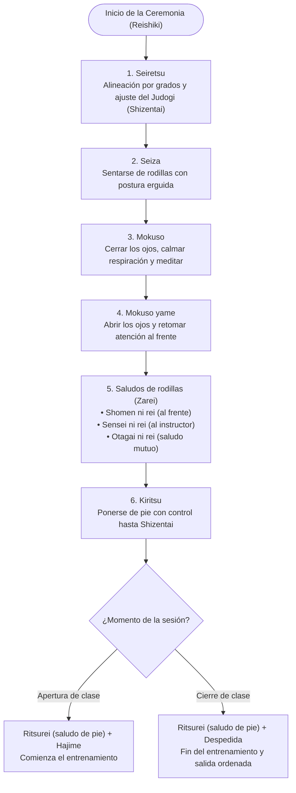

# Ceremonia de Inicio y Cierre de Entrenamiento en Judo (*Reishiki*)

En el judo internacional (bajo la tradición del **Kodokan** y los estándares de la **IJF**), el ritual de apertura y cierre de una sesión de entrenamiento se denomina **Reishiki** (etiqueta y ceremonia del saludo). Su finalidad es establecer la transición mental desde la vida cotidiana hacia la concentración, el respeto mutuo (**Rei**) y el autocontrol dentro del tatami.

---

## Organización Previa en el Tatami

Antes de iniciar la ceremonia, todos los participantes deben observar las siguientes normas de disposición:

* **Alineación (*Seiretsu*):** Los judokas se forman en una o varias filas rectas ordenadas de mayor a menor grado (**Dan** / **Kyu**) y antigüedad, mirando hacia el **Shomen** (frente principal o ceremonial del dojo).
* **Ubicación del Instructor (*Sensei*):** Se sitúa al frente, de cara a los alumnos (o girando hacia el *Shomen* durante el saludo ceremonial correspondiente).
* **Presentación del *Judogi*:** Antes de comenzar, cada practicante ajusta su chaqueta (*uwagi*) y cinturón (*obi*) con discreción y guarda silencio.
* **Postura Inicial (*Shizentai*):** De pie, postura natural, pies separados al ancho de los hombros, brazos relajados a los costados y mirada al frente.

---

## 1. Ceremonia al INICIAR el Entrenamiento

### Paso 1: Formación y Atención (*Seiretsu* / *Kiotsuke*)
* El instructor o el alumno de mayor grado da la indicación de alinearse (**Seiretsu**).
* Todos adoptan una actitud atenta, silenciosa y erguida en **Shizentai**.

### Paso 2: Sentarse de Rodillas (*Seiza*)
A la voz de **"Seiza"** (o *"Za"*), los practicantes descienden al tatami de manera controlada y ordenada:
1. Se baja primero la rodilla izquierda y luego la derecha (evitando golpear el tatami).
2. Los empeines se apoyan planos hacia atrás y los glúteos descansan sobre los talones.
3. Las rodillas mantienen una separación aproximada de dos puños.
4. La espalda permanece recta, los hombros relajados y las palmas de las manos descansan sobre los muslos.

### Paso 3: Meditación Silenciosa (*Mokuso*)
* El instructor pronuncia **"Mokuso"**.
* Los practicantes cierran los ojos suavemente, relajan la tensión muscular y regulan su respiración de forma calmada y natural.
* El propósito es despejar distracciones externas y enfocar la mente en el aprendizaje seguro y respetuoso.
* Tras unos instantes, el instructor indica **"Mokuso yame"** (fin de la meditación); los alumnos abren los ojos y retoman la mirada al frente.

### Paso 4: Saludos Ceremoniales (*Zarei*)
Se ejecuta el saludo tradicional de rodillas (**Zarei**): se deslizan ambas manos hacia adelante apoyándolas en el tatami formando un triángulo suave frente a las rodillas, se inclina el tronco con dignidad sin elevar los glúteos de los talones, se hace una breve pausa y se regresa a la postura erguida.

1. **Saludo al frente principal (*"Shomen ni rei"*):** Todos realizan **Zarei** hacia el *Shomen*.
2. **Saludo al instructor (*"Sensei ni rei"*):** Todos realizan **Zarei** hacia el profesor (en algunos dojos se acompaña de la expresión *"Onegai shimasu"*, que significa "por favor, enséñeme / entrenemos bien").
3. **Saludo mutuo (*"Otagai ni rei"*):** En el formato internacional, se realiza también un saludo entre todos los compañeros para reafirmar el cuidado y respeto mutuo.

### Paso 5: Ponerse de Pie (*Kiritsu*) y Comenzar (*Hajime*)
* A la indicación de **"Kiritsu"** (ponerse de pie):
  1. Se apoya la punta de los dedos de los pies en el tatami para estabilizar la base.
  2. Se eleva el tronco de manera fluida y sin perder el equilibrio (habitualmente adelantando primero la pierna derecha) hasta volver a **Shizentai**.
* Tras un saludo de pie (**Ritsurei**) si el instructor lo marca, se pronuncia **"Hajime"** para dar inicio al calentamiento o a la práctica de caídas (*Ukemi*).

---

## 2. Ceremonia al FINALIZAR el Entrenamiento

El cierre sigue la misma secuencia formal, orientada a calmar la activación física, interiorizar lo aprendido y agradecer la práctica compartida:

1. **Reunión y Alineación (*Seiretsu*):** Al concluir el *Randori* o los ejercicios finales, los judokas vuelven a formarse en orden de grado, arreglan su *judogi* y recuperan la calma.
2. **Sentarse de Rodillas (*Seiza*):** A la orden del instructor, todos toman asiento en **Seiza**.
3. **Meditación Final (*Mokuso* → *Mokuso yame*):** Se cierran los ojos para regular la respiración tras el esfuerzo y reflexionar sobre el entrenamiento realizado y la actitud mantenida con los compañeros.
4. **Saludos de Cierre (*Zarei*):**
   * **"Shomen ni rei"** → Saludo de rodillas al frente principal.
   * **"Sensei ni rei"** → Saludo de rodillas al instructor (acompañado tradicionalmente de *"Arigato gozaimashita"*, "muchas gracias por la enseñanza").
   * **"Otagai ni rei"** → Saludo mutuo entre todos los practicantes para agradecer al compañero de práctica.
5. **Ponerse de Pie (*Kiritsu*) y Despedida:** Todos se incorporan a **Shizentai**, realizan un último saludo de pie (**Ritsurei**) si así se indica y rompen filas manteniendo el orden al salir del tatami.

---

## Diagrama de Flujo de la Ceremonia (*Reishiki*)

El siguiente diagrama resume la secuencia completa desde la formación inicial hasta el cierre de la clase:

---

## Resumen Rápido de Comandos Ceremoniales

| Comando / Término | Traducción / Significado | Acción del Practicante |
| :--- | :--- | :--- |
| **Seiretsu** | Alinearse / Formar filas | Ubicarse en fila recta según grado y antigüedad. |
| **Seiza** | Sentarse correctamente | Arrodillarse de forma ordenada con los glúteos sobre los talones. |
| **Mokuso** | Meditación silenciosa | Cerrar los ojos, relajar el cuerpo y concentrar la respiración. |
| **Mokuso yame** | Fin de la meditación | Abrir los ojos y enfocar la vista al frente. |
| **Zarei** | Saludo de rodillas | Apoyar manos en triángulo en el tatami e inclinar el tronco. |
| **Shomen ni rei** | Saludo al frente principal | Ejecutar **Zarei** hacia el *Shomen*. |
| **Sensei ni rei** | Saludo al maestro / instructor | Ejecutar **Zarei** hacia el profesor. |
| **Otagai ni rei** | Saludo mutuo | Ejecutar **Zarei** entre todos los compañeros. |
| **Kiritsu** | Ponerse de pie | Incorporarse con equilibrio hasta quedar en **Shizentai**. |
| **Ritsurei** | Saludo de pie | Inclinación formal del tronco desde la postura **Shizentai**. |
| **Hajime** | Comenzar | Iniciar la práctica o actividad indicada. |