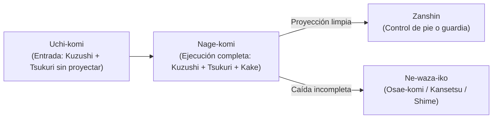
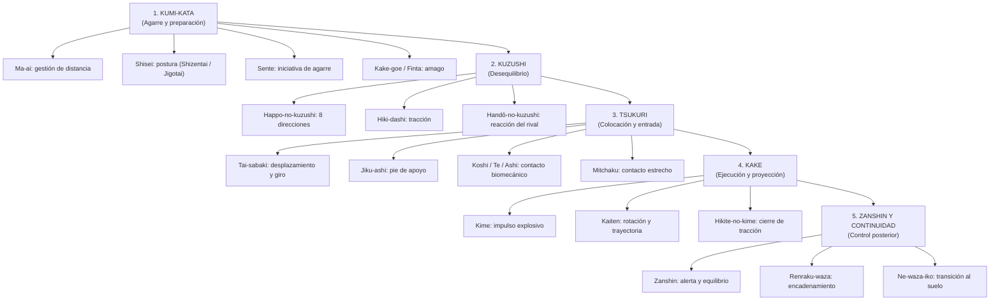

# Fases de Ejecución de una Técnica de Judo (*Nage-waza*)

En el judo, la ejecución de una técnica de proyección (**Nage-waza**) se divide clásicamente en tres fases fundamentales —**Kuzushi**, **Tsukuri** y **Kake**—, a las que en la práctica real y competitiva se suman el agarre inicial y el control final tras la caída.

Dentro de la metodología de enseñanza del Kodokan, cada una de estas 5 fases se descompone en acciones técnicas específicas que ocurren en micro-momentos.

---

## 1. Preparación y Agarre (*Kumi-kata*)

Es la fase inicial donde se establece la conexión física y táctica con el oponente (**Uke**) antes de iniciar el ataque.

* **Ma-ai (Gestión de la distancia):** Ajustar el espacio óptimo entre ambos judokas para evitar ataques sorpresa y permitir la entrada propia.
* **Shisei (Postura):** Adoptar la postura natural (*Shizentai*) o defensiva (*Jigotai*) según el momento del combate, manteniendo el centro de gravedad estable.
* **Sente (Iniciativa):** Disputar y asegurar el agarre dominante en el *judogi* (manga y solapa, espalda, cuello o cinturón) antes de que el rival fije el suyo, buscando control sin rigidez.
* **Kake-goe / Finta (Amago):** Leer la reacción del rival y realizar un movimiento previo o ataque falso para provocar una respuesta que abra espacios.

---

## 2. Desequilibrio (*Kuzushi*)

Consiste en romper la estabilidad de **Uke** para llevarlo a un punto en el que no pueda defenderse ni recomponer su postura fácilmente.

* **Happo-no-kuzushi (Las 8 direcciones):** Dirigir el centro de gravedad de **Uke** hacia uno de los 8 puntos cardinales donde su base de apoyo sea débil (adelante, atrás, izquierda, derecha y las 4 diagonales).
* **Hiki-dashi (Tracción):** Coordinar el uso de las manos (*Hikite* para la manga y *Tsurite* para la solapa) para tirar o levantar, sacando el peso de los talones o de las puntas de los pies del oponente.
* **Handō-no-kuzushi (Desequilibrio por reacción):** Aprovechar el momento en que el rival empuja o tira en sentido contrario para sumar su propia fuerza e inercia al movimiento de ataque.

---

## 3. Adaptación o Colocación del Cuerpo (*Tsukuri*)

Es el posicionamiento exacto de **Tori** (quien ejecuta la técnica) en ventaja biomecánica para cargar, barrer, enganchar o proyectar a **Uke**, manteniendo el control obtenido en el desequilibrio.

* **Tai-sabaki (Movimiento corporal):** Desplazar los pies y girar el cuerpo de forma fluida sin cruzar las piernas innecesariamente (mediante pasos deslizantes *Tsugi-ashi* o giros *Mawari-sabaki*).
* **Jiku-ashi (Pie de apoyo):** Plantar con firmeza la pierna que sostendrá el eje de rotación o el equilibrio durante toda la ejecución de la técnica.
* **Koshi / Te / Ashi (Contacto biomecánico):** Ubicar la cadera por debajo del centro de gravedad del oponente, posicionar la pierna de barrido o siega, o alinear los brazos según la familia de la técnica.
* **Mitchaku (Contacto estrecho):** Eliminar el espacio vacío entre el pecho o la espalda de **Tori** y el cuerpo de **Uke** para transmitir la fuerza sin pérdidas de energía.

---

## 4. Ejecución o Proyección (*Kake*)

Es el momento culminante donde se aplica el impulso final, uniendo cadera, piernas, tronco y agarres en un movimiento continuo para lanzar a **Uke** hacia el tatami.

* **Kime (Impulso explosivo):** Aplicar la aceleración máxima mediante la extensión de piernas, el giro de cadera o la acción de palanca en el instante justo.
* **Kaiten (Rotación / Trayectoria):** Guiar el arco de vuelo de **Uke** para que su espalda se dirija limpiamente hacia el tatami, evitando que caiga de frente o de lado.
* **Hikite-no-kime (Cierre de tracción):** Tirar de la manga hacia abajo y hacia el propio cuerpo en el último tramo para asegurar un impacto limpio y controlar el aterrizaje de forma segura.

---

## 5. Control Posterior y Continuidad (*Zanshin* / Transición a *Ne-waza*)

La acción no termina cuando el rival toca el suelo; esta fase garantiza la seguridad, la puntuación y la continuidad del combate.

* **Zanshin (Alerta y postura):** Terminar de pie o en una posición equilibrada, manteniendo la mirada en el oponente, el control y la guardia activa inmediatamente después de proyectar.
* **Renraku-waza (Encadenamiento):** Si la técnica inicial falla o es bloqueada por el rival, enlazar sin pausa con una segunda proyección en otra dirección.
* **Ne-waza-iko (Transición al suelo):** Si la caída no es definitiva (*Ippon*), seguir el movimiento de **Uke** para caer en posición de ventaja e iniciar de inmediato inmovilizaciones (*Osae-komi-waza*), luxaciones (*Kansetsu-waza*) o estrangulaciones (*Shime-waza*).

---

## Nota Metodológica de Entrenamiento

La transición entre **Kuzushi**, **Tsukuri** y **Kake** debe ser continua y sin pausas bruscas; separarlas en exceso otorga tiempo a **Uke** para defenderse o contrarrestar (*Kaeshi-waza*).

En el entrenamiento tradicional, estas subpartes se mecanizan primero de forma aislada mediante **Uchi-komi** (repeticiones de entrada centradas en el *Kuzushi* y *Tsukuri* sin proyectar) antes de pasar al **Nage-komi** (ejecución completa de la técnica incluyendo el *Kake*).

---

## Diagrama General de Ejecución (*Nage-waza*)

Esquema secuencial de las 5 fases principales y sus subpartes técnicas. La transición entre fases debe ser fluida y continua en el tatami.

